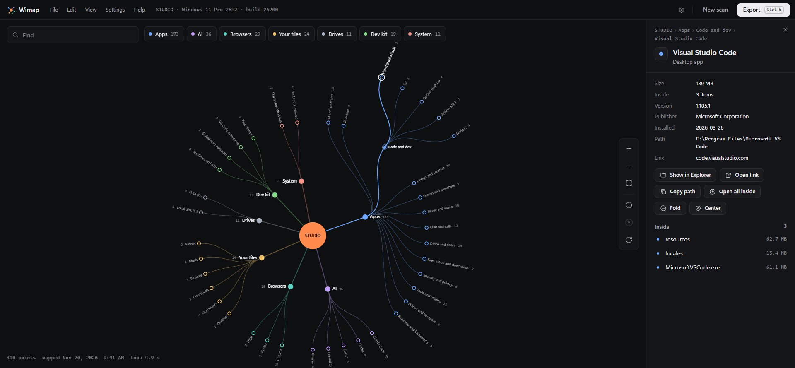
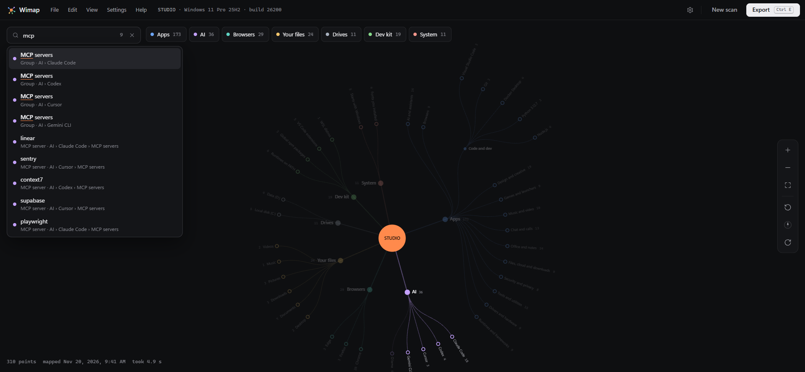
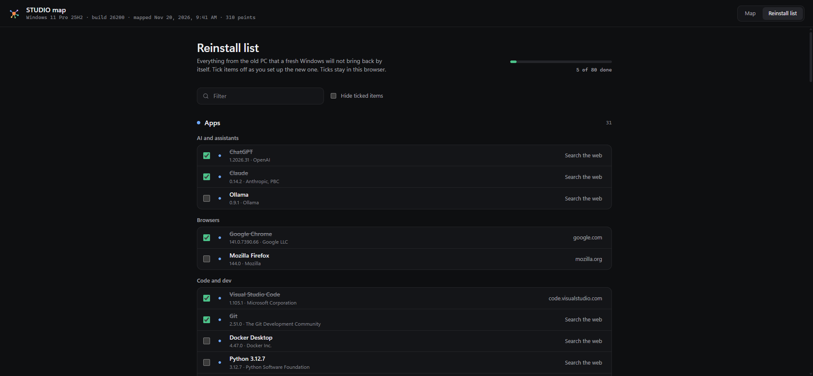

<p align="center">
  
</p>

<h1 align="center">Wimap</h1>

<p align="center">A map of everything on your Windows PC, so you know what to bring with you to the next one.</p>

<p align="center">
  <a href="https://github.com/Prism99-collab/Wimap/releases/latest">Download for Windows</a> ·
  <a href="#what-it-finds">What it finds</a> ·
  <a href="#privacy">Privacy</a> ·
  <a href="#building-from-source">Building from source</a>
</p>



Setting up a new PC usually means trying to remember what was on the old one. Which apps, which browser extensions, which MCP servers you wired into Claude Code six months ago, which font that one project needed. Wimap scans the PC in a few seconds and draws all of it as one radial map you can search, fold and rotate. When you're done, it saves the whole thing as a single HTML file that opens in any browser, offline, with a checklist of what to reinstall.

The screenshots use a made-up machine called STUDIO.

## Download

Get `WimapSetup-<version>.exe` from the [latest release](https://github.com/Prism99-collab/Wimap/releases/latest) and run it. It installs for your account only, so it doesn't ask for admin rights, and it adds Wimap to the Start menu and to Settings › Apps. If the PC is missing the Microsoft WebView2 runtime (only some older Windows 10 machines are), setup downloads it for you.

Prefer not to install anything? `Wimap.exe` from the same release runs on its own.

Windows SmartScreen may say "Windows protected your PC" the first time, because the release isn't code-signed yet. Click **More info**, then **Run anyway**.

Wimap needs 64-bit Windows 10 (version 2004 or later) or Windows 11.

## What it finds

| Branch | Where it looks |
| --- | --- |
| Apps | Installed programs from the registry, Microsoft Store apps, Steam and Epic games. Each app's own folder is walked, so you see its size and the programs inside it. |
| AI tools | Claude Code and Claude desktop, Codex, Gemini CLI, Cursor, GitHub Copilot CLI, Windsurf, VS Code, Cline, Kiro, Qwen Code, opencode and Continue. For each one: MCP servers, plugins, skills, agents, commands and memory files. Local models in Ollama and LM Studio too. |
| Browsers | Bookmarks and extensions for every profile in Chrome, Edge, Brave, Vivaldi, Opera, Opera GX, Arc, Firefox, Zen, LibreWolf and a few others. |
| Your files | Desktop, Documents, Downloads, Pictures, Music, Videos and OneDrive. Folders that Windows redirected into OneDrive are counted once. |
| Drives | Every internal and removable disk, with used and free space and its top folders. |
| Dev kit | Runtimes on your PATH, global npm packages, editor extensions (VS Code, Cursor, Windsurf, VSCodium) and WSL distros. |
| System | Programs that start with Windows, and fonts you installed yourself. |

## Finding things



Search ignores case and accents, so `resume` finds "Résumé". Every word you type has to match somewhere. Put a phrase in quotes to match it exactly, and use `in:browsers` or `is:extension` to narrow things down. Results show where each item sits, and the branches that contain matches stay lit while the rest of the map dims.

Getting around:

- Drag to move, scroll to zoom, right-drag or Alt+scroll to rotate.
- On a touch screen, pinch to zoom and twist two fingers to rotate.
- Click a dot to open or fold that branch, double-click to zoom in on it.
- With the map focused, the arrow keys walk from item to item. Press F1 for every shortcut.

The details panel can sit on the right, on the left or along the bottom, and you can drag its edge to resize it. Label size, line style, animations and a few other things are under Settings.

## Taking it with you



**File › Export HTML** saves the map as one file that opens offline in any browser. It includes the reinstall list above. Every app, extension, MCP server and dev tool is there with a link to get it again, and your ticks are remembered in that browser. The outline on the left shows how far along each section is and jumps straight to it, and the filter plus All, To do and Done narrow a long list down to what's left. Before saving you can leave out bookmarks, hide your user folder from paths, and drop the app icons to make the file smaller.

If you tick the winget option, Wimap also saves a winget file next to the map. On the new PC, `winget import -i <file>` reinstalls most of your apps in one go.

You can also export the map as a PNG, JPEG or SVG image, or save the raw map data and open it again later with **File › Open a map file**.

## Privacy

Everything stays on your PC. Wimap reads names, sizes and versions. It never opens passwords, cookies, browsing history or auth files, and it never sends anything anywhere.

AI tool configs often hold API keys, so Wimap is careful with them. For an MCP server it keeps the server's name and the program that launches it (`npx`, `uvx`, or the host name of a remote server). Environment variables, headers and anything in the arguments that looks like a key are skipped. Bookmark links lose query values such as `token=` or `sig=` and any `user:password@` part, so a shared map doesn't carry them.

Your last map is kept in `%LOCALAPPDATA%\Wimap` so it opens instantly next time. **Settings › Preferences › Forget saved map** deletes it, and so does the uninstaller if you say yes when it asks.

The full policy is in [PRIVACY.md](PRIVACY.md).

## Building from source

You need the .NET 8 SDK and Node.js 20 or later. For the installer you also need [Inno Setup 6](https://jrsoftware.org/isinfo.php), which you can get with `winget install JRSoftware.InnoSetup`.

```powershell
dotnet test tests/Wimap.Tests
node --test (Get-ChildItem tests/ui/*.test.js).FullName
dotnet publish src/Wimap -c Release -o dist
```

That gives you a self-contained `dist\Wimap.exe`. `installer\build.ps1` runs the tests, publishes, and then builds `dist\WimapSetup-<version>.exe`. The version number lives in `src/Wimap/Wimap.csproj`. Pushing a tag such as `v1.0.1` makes GitHub Actions build both files and attach them to a release.

`installer\build-msix.ps1` builds the Microsoft Store package (it needs the Windows SDK). [installer/msix/STORE-LISTING.md](installer/msix/STORE-LISTING.md) has the Partner Center values it takes and everything to paste into the submission.

The app is a small C# host (WinForms and WebView2) around a plain HTML, CSS and JavaScript interface in `src/Wimap/ui`. In Debug builds, setting `WIMAP_UI` to that folder makes the app load the interface from disk, so a reload shows your edits without rebuilding, and `WIMAP_DEVTOOLS=1` turns on the browser developer tools. Release builds ignore both. `Wimap.exe --scan out.json` runs a scan without opening a window.

```
src/Wimap/        the app: window, scanners (Scan/) and interface (ui/)
installer/        Inno Setup script, Store package (msix/) and build scripts
tests/            scanner tests (xUnit) and interface tests (node --test)
```

Logs go to `%LOCALAPPDATA%\Wimap\wimap.log`.

To report a security problem, see [SECURITY.md](SECURITY.md).

## License

Copyright © 2026 Prism99. All rights reserved.

You're welcome to download and use the released app. The source code is published so you can see how Wimap works and check what it reads on your PC. It is not licensed for reuse: you may not copy, modify, redistribute or sell the code or the app, in whole or in part, without written permission.
